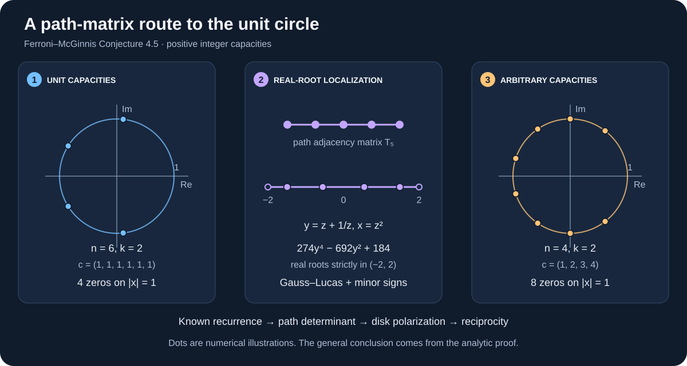

# Ferroni–McGinnis: zeros on the unit circle

**An AI-assisted analytic proof manuscript for Conjecture 4.5, with exact, reproducible checks.**

[Read the proof](docs/PROOF.md) · [Reproduce the checks](#reproduce-the-checks) · [Attribution and prior work](docs/SOURCES.md) · [中文说明](README.zh-CN.md)



**Status, 4 November 2026.** The argument covers every positive integer capacity vector. Two separate AI reviews found no mathematical gap. It has **not received human peer review or formal proof-assistant verification**. A September 2026 MathOverflow comment links a potentially relevant earlier solution that could not be inspected. **Novelty and priority are unresolved; this repository claims neither.** [Review status and limitations →](docs/REVIEW_STATUS.md)

## The question

Give each label $`i`$ a positive integer capacity $`c_i`$. For a permutation with $`k`$ cycles, a cycle $`C`$ may receive any weight from $`0`$ to $`c(C)-1`$, where $`c(C)=\sum_{i\in C}c_i`$. Count these weighted permutations by their total weight:

```math
P_{n,k,\mathbf c}(x)
=\sum_{\substack{\sigma\in S_n\\\mathrm{cyc}(\sigma)=k}}
\prod_{C\text{ cycle of }\sigma}\bigl(1+x+\cdots+x^{c(C)-1}\bigr).
```

**Claim proved in the manuscript:** for $`n\ge1`$, $`1\le k\le n`$ and every $`\mathbf c\in\mathbb Z_{>0}^n`$, every complex zero of $`P_{n,k,\mathbf c}`$ has modulus $`1`$.

This is [Ferroni–McGinnis, Conjecture 4.5](https://arxiv.org/html/2202.11808v2#S4.SS2), with their index $`m`$ replaced by $`k-1`$. The degree is $`\sum_i c_i-k`$. Constant polynomials have no zeros, so the claim is vacuous in the degree-zero case.

## Why the proof works

1. **Start with capacities all equal to one.** A known weighted-Lah recurrence becomes a tridiagonal determinant. With $`T_{n-1}`$ the adjacency matrix of a path and $`B=\mathrm{diag}(1,1/2,\ldots,1/(n-1))`$, coefficient extraction gives

   ```math
   P_{n,k,\mathbf1}(z^2)=(n-1)!\,z^{n-k}[s^{k-1}]\det\bigl((z+z^{-1})I-T_{n-1}+sB\bigr).
   ```

2. **Locate the determinant coefficient's roots.** An elementary kernel-vector argument and Gauss–Lucas put them on the real line. Principal-minor signs put them strictly between $`-2`$ and $`2`$. The substitution $`y=z+z^{-1}`$ then puts the original zeros on the unit circle.

3. **Transfer to every positive capacity vector.** A symmetric multiaffine cycle polynomial is zero-free in the open unit disk by the classical Grace–Walsh–Szegő theorem. Substituting $`u_i=x^{c_i}`$ excludes interior zeros. Reciprocal symmetry excludes exterior zeros.

All reductions, determinant factors, boundary cases and the precise external theorem used are given in the [proof](docs/PROOF.md). The recurrence and generating function are established antecedents, not new results of this repository.

## A concrete example

For six labels, two cycles and capacities all equal to one,

```math
P_{6,2,\mathbf1}(x)=274+404x+444x^2+404x^3+274x^4.
```

Its doubled transform is

```math
P_{6,2,\mathbf1}(z^2)=z^4\left(274y^4-692y^2+184\right),\qquad y=z+z^{-1}.
```

The four roots of the transformed polynomial lie in $`(-2,2)`$, so the four roots of $`P`$ lie on the unit circle. The illustration plots this example alongside the unequal-capacity example $`\mathbf c=(1,2,3,4)`$, $`k=2`$. Coordinates are numerical illustrations; the finite root certifications use exact arithmetic.

## Reproduce the checks

Python 3.10 or newer is required. The reference run uses Python 3.12.14 and SymPy 1.14.0.

```sh
python -m venv .venv
# Linux/macOS:
. .venv/bin/activate
# Windows PowerShell instead: .venv\Scripts\Activate.ps1
python -m pip install -r requirements.txt
python checks/run_all.py
```

The suite checks:

- **28 exact determinant identities:** every $`1\le k\le n\le7`$, compared with direct permutation enumeration.
- **10 exact subset-expansion identities:** all cycle counts for $`(1,2,3)`$, $`(2,3,5)`$ and $`(1,2,3,4)`$.
- **404 exact unit-circle certifications:** all capacities in $`\{1,2,3\}^n`$ up to coordinate permutation for $`1\le n\le6`$, every cycle count, plus four larger asymmetric vectors. The polynomial comes from a subset-cycle dynamic program independent of the determinant identity. A reciprocal transformation and exact Sturm root counts handle multiplicities.
- **28 exact spectral checks** of the determinant coefficient polynomials, plus regression tests for boundary cases, invalid inputs and the root-certification mechanism.

[Verification details and results →](docs/VERIFICATION.md)

**The finite checks are tests of formulas and implementations, not a proof for all parameters.** The analytic proof does not depend on their output.

To regenerate the original SVG illustration after installing the same dependency:

```sh
python scripts/make_figure.py
```

## Attribution and scope

- **Conjecture and objects:** Luis Ferroni and Daniel McGinnis, *Lattice points in slices of prisms*, Conjecture 4.5 and Definition 3.7 ([arXiv v2](https://arxiv.org/html/2202.11808v2), [published article](https://www.cambridge.org/core/journals/canadian-journal-of-mathematics/article/lattice-points-in-slices-of-prisms/BD4DAAE19B3FBECB840B658A189198ED)).
- **Weighted-Lah recurrence and generating function:** Luis Ferroni, *Hypersimplices are Ehrhart Positive*, Remark 3.11 and Theorem 3.12 ([arXiv v2](https://arxiv.org/pdf/1911.10146v2)). The later [MathOverflow discussion](https://mathoverflow.net/questions/449688/partitions-weights-and-polynomials-with-roots-on-the-unit-circle) includes Richard Stanley's generating-function comment and Ferroni's recurrence comment.
- **Classical transfer theorem:** Grace–Walsh–Szegő, in the open-disk form recorded by Petter Brändén and David G. Wagner, Proposition 1 ([arXiv](https://arxiv.org/pdf/0809.3225)). The determinant argument is also consistent with classical stability theory and is not claimed as a new general lemma.
- **Unresolved earlier lead:** [Veronica Phan's 24 September 2026 comment](https://mathoverflow.net/questions/449688/partitions-weights-and-polynomials-with-roots-on-the-unit-circle#comment1347048_449688) links a possible solution. Its content and relationship to this proof remain unknown. See the [source register](docs/SOURCES.md).

This work concerns the weighted-permutation **unit-circle conjecture only**. It does not establish the distinct $`h^*`$-real-rootedness or interlacing conjectures for slices of prisms. No source paper, third-party conversation, private review transcript or third-party image is redistributed here.
