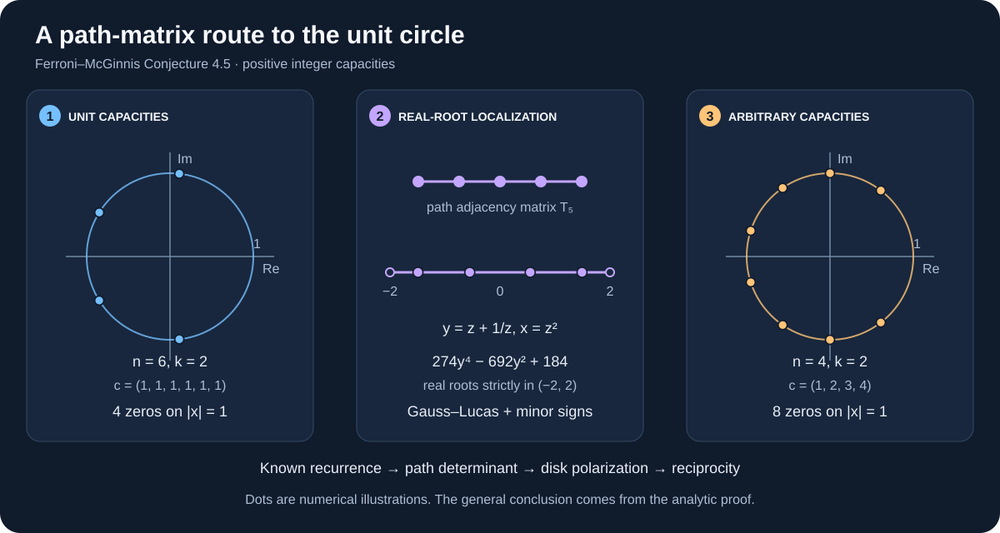

# Ferroni–McGinnis：零点为何都在单位圆上

**针对猜想 4.5 的 AI 辅助解析证明稿，附可复现的精确检验。**

[完整证明（英文）](docs/PROOF.md) · [来源与归属](docs/SOURCES.md) · [English](README.md)



**状态，2026 年 11 月 4 日：**证明稿覆盖任意正整数容量向量。两次独立开展的 AI 审核均未发现数学缺口；尚未经过人类同行评审，也未完成形式化证明。2026 年 9 月的一条 MathOverflow 评论链接了一个可能相关的更早解答，但该链接内容未能读取。**创新性与优先权尚未确定，本仓库不作首次证明的声明。**

## 问题是什么？

给每个标签 $i$ 一个正整数容量 $c_i$。在一个恰有 $k$ 个循环的排列中，每个循环 $C$ 可以取 $0$ 到 $\sum_{i\in C}c_i-1$ 之间的整数权重。按总权重计数，得到

$$P_{n,k,\mathbf c}(x)=\sum_{\substack{\sigma\in S_n\\\operatorname{cyc}(\sigma)=k}}\prod_{C\text{ cycle of }\sigma}\bigl(1+x+\cdots+x^{\sum_{i\in C}c_i-1}\bigr).$$

证明稿的结论是：对所有 $n\ge1$、$1\le k\le n$、$\mathbf c\in\mathbb Z_{>0}^n$，这个多项式的每一个复零点都满足 $|x|=1$。这正是 [Ferroni–McGinnis 猜想 4.5](https://arxiv.org/html/2202.11808v2#S4.SS2)，其中原文的 $m$ 对应这里的 $k-1$。

## 三步证明思路

1. **先处理容量全为 1 的情形。** 将已有的加权 Lah 数递推写成路径矩阵的三对角行列式。
2. **把零点压到实区间。** 核向量恒等式和 Gauss–Lucas 定理给出实根性；主子式的符号把零点限制在 $(-2,2)$。代换 $y=z+z^{-1}$ 随即得到单位圆上的零点。
3. **推广到任意正整数容量。** 用经典 Grace–Walsh–Szegő 定理得到多变量多项式在开单位圆盘内无零点，再代入 $u_i=x^{c_i}$。倒数对称性排除圆盘外的零点。

[完整证明](docs/PROOF.md)逐项写明了归一化系数、边界情形和调用的经典定理。递推、生成函数及经典稳定性工具均有明确归属，不作为本仓库的新发现。

## 如何复现

安装 Python 3.10 或更新版本，然后运行：

```sh
python -m pip install -r requirements.txt
python checks/run_all.py
```

参考环境为 Python 3.12.14、SymPy 1.14.0。检验包括：

- $n\le7$ 的全部 **28 个**排列枚举与行列式精确恒等式；
- 三组不等容量向量的 **10 个**子集展开恒等式；
- **404 个**用子集循环动态规划和精确 Sturm 根计数完成的单位圆认证；
- **28 个**行列式系数多项式的精确实根检验，以及常数、多重根、边界情形及错误输入的回归测试。

**有限计算检验不能代替一般证明。** 图中的根坐标仅用于直观展示；一般结论来自解析论证。[检验说明 →](docs/VERIFICATION.md)

## 归属与边界

猜想及组合对象来自 Luis Ferroni 与 Daniel McGinnis 的 *Lattice points in slices of prisms*。递推和生成函数此前已出现在 Ferroni 的 *Hypersimplices are Ehrhart Positive*，Remark 3.11 与 Theorem 3.12；2023 年的 MathOverflow 讨论也记录了 Stanley 的生成函数评论及 Ferroni 的递推评论。

[Veronica Phan 于 2026 年 9 月 24 日的评论](https://mathoverflow.net/questions/449688/partitions-weights-and-polynomials-with-roots-on-the-unit-circle#comment1347048_449688)链接了可能相关的解答。该共享对话读取时返回 HTTP 403，未绕过访问限制，也无法判断它的内容、正确性或与本证明的关系。详情见[来源记录](docs/SOURCES.md)和[审核状态](docs/REVIEW_STATUS.md)。

本稿只涉及加权排列的单位圆猜想，不解决棱柱切片的其他 $h^*$ 实根性或交错性猜想。仓库不包含第三方论文全文、共享对话内容、私有审核记录或第三方图片。
